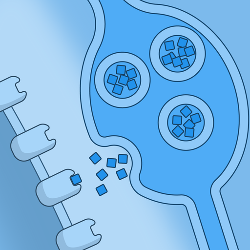
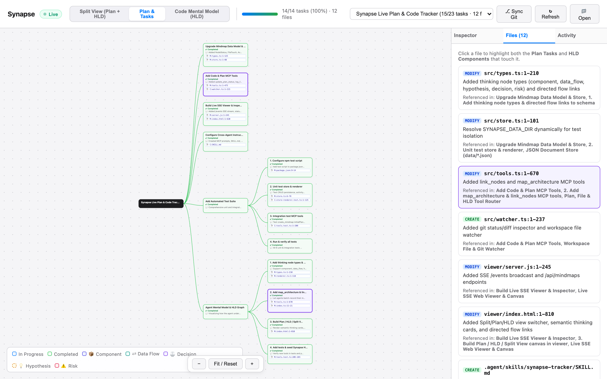

<p align="center"></p>
<p align="center"><a href="https://www.npmjs.com/package/synapse-mindmap"></a></p>

# Synapse – Live Plan, Code & Mental Model Mindmap for Any Agent

**Synapse** is an MCP server + live web viewer that lets **any coding agent** (Claude Code, Claude Desktop, Cursor, OpenCode, Codex, Windsurf, etc.) maintain a real-time visual mindmap of:
1. **What the plan is** (hierarchical tasks with `planned`, `in_progress`, `completed`, and `blocked` statuses)
2. **How the agent is thinking about the code (HLD / Mental Model)** (semantic `component`, `data_flow`, `decision`, `hypothesis`, and `risk` cards connected by directed flow links)
3. **Which files and symbols are being touched** (line ranges, symbols, diff summaries, and cross-highlighting between plan tasks and architectural components)

📖 **Docs:** https://vss96.github.io/synapse/

## Quick Start

Requires Node ≥ 20.

```bash
# Register Synapse with the coding agents installed on this machine
npx synapse-mindmap init

# Watch your agent work (port 4040, or the next free port)
npx synapse-mindmap viewer --open
```

`init` detects Claude Code, Claude Desktop, Cursor, OpenCode and Codex (which also covers the ChatGPT desktop app), asks before configuring each one, and backs up any config file it edits. Restart your agent afterwards. Mindmaps are stored in `~/.synapse/data` (override with `SYNAPSE_DATA_DIR`). See the [client guide](https://vss96.github.io/synapse/guide/clients) for manual setup, and [Updating](https://vss96.github.io/synapse/guide/clients#updating) for getting new releases.

---

## Screenshots

### 1. Code Mental Model & High-Level Design (HLD) View
Visualize how the agent understands the system architecture, data flows, design decisions, hypotheses, and risks—without reading walls of text:


### 2. Split View (Plan Tree + Code Mental Model)
See the full execution plan and the architectural mental model side-by-side in a single live canvas. The **Sessions** panel on the left lists every mindmap with its active task, progress, and a live dot; filter it or switch with **⌥↑/⌥↓**:


### 3. Plan & Tasks View + Changes Tab
The **Changes** tab shows what kind of change the agent made in each file (added, modified, fixed, refactored, renamed, removed, tested). Pick a kind to highlight every plan task and HLD component with that kind of change:



### 4. Live Activity Stream
Track a real-time chronological log of every plan update, HLD mapping, and file edit:


### 5. Archiving Sessions
Sessions are grouped by repository. Hover over a finished session and click **Archive** to tuck it into the collapsed **Archived** group at the bottom; nothing is deleted, and **Restore** brings it back:


---

## MCP Tools

| Tool | Description |
|---|---|
| `create_mindmap` | Create a new mindmap with `title`, `workspacePath`, and optional `initialPlan` steps |
| `map_architecture` | Batch-record the agent's mental model / HLD (`component`, `data_flow`, `decision`, `hypothesis`, `risk` nodes + directed `links`) |
| `link_nodes` | Create a directed conceptual or data/control-flow arrow between two nodes (`solid`, `dashed`, or `animated`) |
| `update_plan_status` | Mark a task node `planned`, `in_progress`, `completed`, or `blocked`, and optionally start `nextNodeId` |
| `log_file_touch` | Attach a touched file (`path`, `action` incl. `rename` + `previousPath`, `lines`, `summary`) and symbol-level `changes` (`add`, `modify`, `fix`, `refactor`, `rename`, `remove`, `test`) to the active task or component node |
| `sync_git_status` | Inspect `git status` & `git diff` in the workspace and auto-attach changed files (including staged renames) to the mindmap |
| `get_plan_summary` | Render a Markdown dashboard of task progress (%), HLD concept count, and all touched files |
| `add_node` | Add a child task, plan step, HLD concept, file, or note node |
| `update_node` | Update a node's label, status, semantic type, notes, or files |
| `remove_node` | Remove a node and all its descendants |
| `list_mindmaps` | List all stored mindmaps sorted by most recently updated |
| `get_mindmap` | Get full mindmap data as JSON |
| `render_mindmap` | Render as `mermaid`, indented `text`, or `json` |
| `delete_mindmap` | Delete an entire mindmap |

## Connect to Any Agent

### 1. MCP Server Config
`npx synapse-mindmap init` writes this for you. To add it by hand, most clients use:
```json
{
  "mcpServers": {
    "synapse": {
      "command": "npx",
      "args": ["-y", "synapse-mindmap", "mcp"]
    }
  }
}
```

### 2. Automatic Agent Behavior
- **Built-in MCP Instructions & Prompt**: Synapse automatically advertises server instructions and the `track-coding-plan` MCP prompt to connected clients.
- **Skill / Rules**:
  - For skill-supporting agents (like Antigravity / Claude): see [`.agent/skills/synapse-tracker/SKILL.md`](.agent/skills/synapse-tracker/SKILL.md).
  - For `CLAUDE.md` / `.cursorrules`: copy the snippet from [`AGENT_INSTRUCTIONS.md`](AGENT_INSTRUCTIONS.md).

## Development

Development uses [Bun](https://bun.sh); the published package is plain Node.js.

```bash
./setup.sh            # bun install, build, write claude.json for this checkout
bun test              # tests
bun run build         # tsc → dist/ (MCP server, CLI, viewer server) + bundled viewer app
bun run dev           # MCP server from source, restarting on changes
bun run viewer        # build, then serve the viewer against ./data
bun run docs:dev      # docs site
```

## License

[MIT](LICENSE). The logo is a public-domain NIAID illustration; see [docs/public/LOGO-CREDITS.md](docs/public/LOGO-CREDITS.md).
