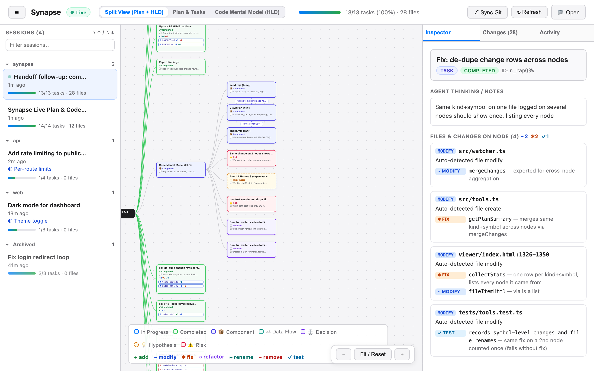
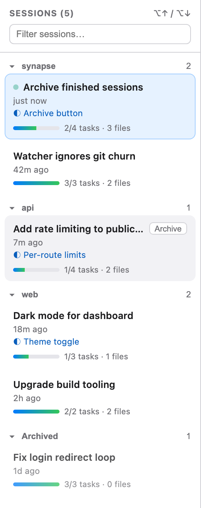
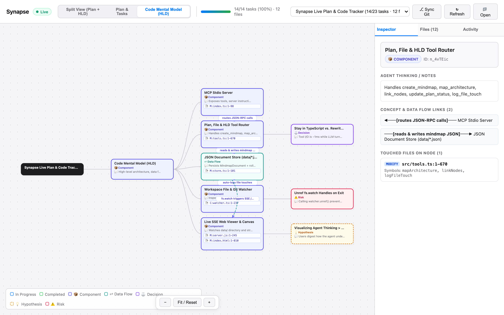
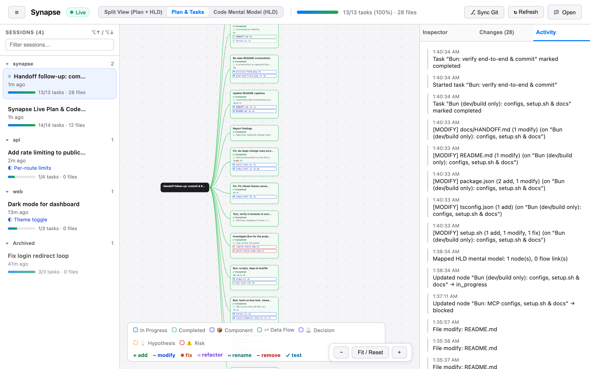

# The Viewer

```sh
npx synapse-mindmap viewer --open
```

The viewer is a local web page that draws every mindmap in your data directory. It updates live while agents work. It only reads the data directory, except for the **Sync Git** button and archiving, restoring or deleting a session. Agents don't need it to be running.

## Layout



| Area | What it shows |
|---|---|
| Header | The sessions toggle (☰), the name of the open session (also on the browser tab), the **Live** indicator, the view switcher, the task progress bar, the **Sync Git**, **Refresh**, and **Open** buttons, and the side panel toggle (◨) |
| Left: Sessions | Every mindmap, grouped by repository, most recently updated first |
| Center: canvas | The plan tree and/or the code mental model |
| Right: sidebar | The **Inspector**, **Changes**, and **Activity** tabs |

## Sessions

Each mindmap is a session. Sessions are grouped by repository, so a repository and all of its git worktrees share one group, named after the main checkout. The group with the most recently updated session comes first, and sessions without a workspace go under **No repository**. Each row shows the title, active task, progress (completed/total tasks), number of files touched, and when it was last updated, plus the name of the worktree if the session ran in one. Hover over a group name to see the full path.

The file count is the files an agent logged, followed by the ones found only by the workspace watcher or a git sync, for example `6 files · 240 auto`. Rows also show what needs your attention: a red **blocked** badge counts blocked tasks, and a green **done** badge marks a session with every task completed. An active task that hasn't changed for a day is dimmed, because the session has probably been abandoned.

- **Groups**: click a group name to collapse or expand it. The viewer remembers which groups you collapsed. While you filter, every match is shown.
- **Archive**: hover over a session and click **Archive** to take it out of the list. A message offers **Undo**. If it was the open session, the next one in the list opens. Archiving hides a finished session without deleting it, and the agent can keep writing to it.
- **Archive completed**: hover over a group name and click **Archive N done** to archive every finished session in the group at once. **Undo** brings them all back.
- **Archived**: the button beside the filter shows how many sessions are archived. Click it to list them, with **Restore** and **Delete** on each one, and again to go back.

  
- **Delete**: on an archived or unreadable session, click **Delete**, then **Confirm** within a few seconds. This removes the mindmap file for good and can't be undone. An unreadable file whose name isn't a mindmap ID has no **Delete** button, so remove it from the data directory yourself. An agent can do the same with [`delete_mindmap`](../reference/tools#delete-mindmap).
- **Live dot**: shown on sessions updated in the last 2 minutes.
- **Filter**: type in the box to narrow the list. It matches session titles, what's inside a session (node labels and notes, up to about 8,000 characters per session), and repository and worktree names. Archived sessions are included, in a group of their own. The header shows how many match, for example **Sessions (34 of 124)**.
- **All / Running / Blocked / Finished**: show only sessions with a task in progress, a blocked task, or every task completed.
- **<kbd>⌥</kbd> <kbd>↑</kbd> / <kbd>⌥</kbd> <kbd>↓</kbd>** (<kbd>Alt</kbd> on Windows and Linux): switch to the previous or next session in the list as shown, skipping collapsed groups.
- **Unreadable sessions**: a mindmap file that can't be read, because of its permissions, damaged JSON, or not being a valid mindmap, is listed at the bottom of the sidebar with the reason. It can't be opened, but you can **Delete** it there, or the agent can remove it with [`delete_mindmap`](../reference/tools#delete-mindmap).
- **Links**: the URL hash holds the session ID, for example `http://localhost:4040/#mm_Ab12Cd34`. Bookmark or share it to open that session directly, or paste it into an open viewer tab to switch to it. A link to a session that doesn't exist leaves the open session on screen and puts its URL back.
- **Back and Forward**: each switch adds an entry to the browser's history, so these buttons step through the sessions you opened.
- **☰** collapses the sidebar. The viewer remembers this setting. In narrow windows it opens the list as a drawer instead.

When an agent updates a session you aren't viewing, only its row changes. The canvas keeps showing the session you picked.

## Views

Use the view switcher in the header to pick what the canvas shows:

| View | Shows |
|---|---|
| **Split View (Plan + HLD)** | The plan tree and the code mental model side by side |
| **Plan & Tasks** | The plan: tasks, their statuses, and the files attached to them |
| **Code Mental Model (HLD)** | The architecture: components, data flows, decisions, hypotheses, and risks, with their labeled flow links |

Plan & Tasks and the HLD view each show one kind of node, plus the cards needed to connect them to the root, drawn faded. So a decision recorded under a task appears in the HLD view under a faded copy of that task, and a task nested in a component appears in the plan under a faded copy of that component. If a view has nothing to show but the root, a message on the canvas says so.



Node cards are colored by status (in progress, completed, blocked) or by concept type (component, data flow, decision, hypothesis, risk). Planned cards stay neutral. See the legend at the bottom of the canvas, which lists only what the current view can show. Cards with logged changes show a tally such as `+2 ✱1 ⟲1`. Labels wrap onto a second line, and anything longer is cut short on the card, as are notes. Hover over a card to read them in full.

The tree grows to the right. In the split view, plan tasks come before the architecture branch, so the mental model never splits the plan in two. A long run of sibling cards without children (7 or more, such as a flat plan) wraps into rows inside a dashed frame, read left to right and then top to bottom. Tasks in the frame are numbered in that order.

A card with children has a small pill on its right edge. Click **−** to fold the branch away, and the pill shows how many cards it's hiding, for example **+3**. Click it again to unfold. **Fold done** in the controls folds every branch whose tasks are all completed, and turns into **Unfold** while anything is folded. The viewer remembers folded branches for each session in your browser. A branch unfolds by itself when you jump to a card inside it or when the agent starts a task inside it.

Flow links run between the cards, and their labels sit in the gaps between columns. Hover over a link or its label to trace it to the cards at both ends and to read its full label and notes. Click a label to go to the card the link starts from.

Drag to pan, and scroll to zoom. Touch and pen drag the canvas too. Zooming centers on the cursor and follows how far you scroll, so a trackpad zooms as smoothly as a mouse wheel. Scrolling sideways doesn't zoom. Pinching a trackpad zooms the canvas the same way in Chrome, Edge, and Firefox. In Safari, a pinch zooms the whole page instead. The controls at the bottom right are:

- **− / +**: zoom around the middle of the canvas.
- **Fit**: show the whole map.
- **◎ Focus**: center the task the agent is working on (the most recently updated task in progress) at full size. If no task in the current view is in progress, it shows the root at the left edge.
- **Fold done** / **Unfold**: see above.
- **?**: show or hide the legend.

When you open a session or switch views, the canvas fits the whole map if its cards are still readable that way. Otherwise it frames the path from the root to the active task at a readable size, so you see where the session started and what it's doing now. If the whole path doesn't fit, the active task stays in view. When the agent starts a different task, the canvas moves the same way. Other live updates leave the canvas where you put it. The selected node has a blue ring around it.

Picking something in the sidebar brings it into view: jumping along a link in the Inspector, clicking an Activity entry, clicking a file, or picking a change kind in the Changes tab. If the node you jump to is hidden in the current view, the view switches to the split view. If the cards are already in view at a readable size, the canvas stays put. Otherwise it pans to them, zooming out only as far as needed to show them all, or zooming in from a far zoomed-out view until they're readable.

## Find on the map

Press <kbd>/</kbd>, or click the box at the top left of the canvas, and type part of a card's label or notes, a file path, a symbol name, or a node ID. Every matching card is highlighted. The first match is selected and brought into view, unless the selected card already matches. The box shows which match is selected, for example **2 of 5**.

- <kbd>Enter</kbd> / <kbd>Shift</kbd> <kbd>Enter</kbd>: select the next or previous match. Matches are in outline order: a card, then its children, top to bottom. Matches hidden in the current view come last, and going to one switches to the split view.
- <kbd>Esc</kbd>: clear the box and the highlight.

A file path or symbol matches every card that logged it, including the old names of renamed files and symbols. When a file is what matched, the Inspector opens with that file marked and scrolled into view, however long the list is. The highlight stays while you keep typing and when live updates arrive.

## Theme and narrow windows

The viewer follows your system's light or dark setting.

To keep room for the session name, the view switcher shows short names (**Split**, **Plan**, **HLD**) below 1400 pixels wide, and the toolbar shows icons only below 1200. When the canvas is too narrow for the legend beside the zoom controls, the legend moves above them. To give the map the whole window, hide the side panel with **◨** or <kbd>]</kbd>, and the legend with **?**. The viewer remembers both. Clicking a card brings the side panel back.

Below 900 pixels wide, for example in a side pane next to your editor, the layout changes:

- The Inspector, Changes, and Activity tabs move below the canvas.
- **☰** opens the session list as a drawer over the canvas. Picking a session, clicking outside the drawer, or pressing <kbd>Esc</kbd> closes it.
- The legend starts closed. **?** opens it above the controls.
- **◨** or <kbd>]</kbd> hides the panel below the canvas.

## Keyboard

| Key | Where | What it does |
|---|---|---|
| <kbd>/</kbd> | Anywhere | Go to the find box |
| <kbd>⌥</kbd> <kbd>↑</kbd> / <kbd>⌥</kbd> <kbd>↓</kbd> | Anywhere | Previous or next session |
| <kbd>]</kbd> | Anywhere | Show or hide the side panel |
| <kbd>Esc</kbd> | Anywhere | Close the session drawer, or clear a file or change-kind highlight |
| <kbd>←</kbd> / <kbd>→</kbd> | On a card | Go to its parent, or to its first child |
| <kbd>↑</kbd> / <kbd>↓</kbd> | On a card | Go to the previous or next sibling |
| <kbd>Enter</kbd> or <kbd>Space</kbd> | On a card | Open it in the Inspector |
| <kbd>-</kbd> / <kbd>+</kbd> | On a card | Fold or unfold its branch |

<kbd>Tab</kbd> reaches the map at the selected card. Moving between cards selects them and brings them into view.

## Inspector

Click a node to inspect it. The Inspector shows:

- The node's parents, as links up to the root.
- The label, type, status, and node ID. Agents use the ID in tool calls, so it's handy when you want to point the agent at a node. Click the ID to copy it.
- **Agent Thinking / Notes**: the node's `notes`.
- **Child Nodes**: the nodes directly below it, with their statuses, plus the progress and changes of the whole branch. Click one to jump to it.
- **Concept & Data Flow Links**: incoming and outgoing arrows with their labels. Click a link to jump to the node at the other end.
- **Files & Changes on Node**: every file attached to the node, with its action, line range, summary, and symbol-level changes. Long lists work like the [Changes tab](#changes-tab).

Selecting another node clears a file highlight.

## Changes tab

The **Changes** tab lists every file in the session:

- **Changed Files**, newest first. Each file shows its action (`create`, `modify`, `rename`, `delete`), its change rows, and the nodes it was logged on ("via").
- **Read for Context**: files the agent only read.

The files an agent logged come first. Files found only by the [workspace watcher](./how-it-works#git-sync-and-the-workspace-watcher) or a git sync are collapsed behind **Auto-detected files (N)**, and the tab label counts them separately, for example **Changes (6 +240)**. Lists show 50 files at a time with a button for more, and a list of 10 or more has a box to filter it by path.

Filter chips at the top (**All**, **+ Added**, **~ Modified**, **✱ Fixed**, **⟲ Refactored**, **↦ Renamed**, **− Removed**, **✓ Tested**) narrow the list to one kind of change. The selected kind is also **highlighted on the canvas**, so you can see at a glance which tasks and components contain, for example, fixes. Click a file to highlight every node that touched it. Click it again to clear the highlight.

## Activity tab

The Activity tab is a timeline of everything that happened in the session, newest first, under a heading for each day (**Today**, **Yesterday**, or the date): mindmap creation, plan status changes, HLD mappings, links, file touches with change tallies, and git syncs. Hover over a time to see the full date. Each session keeps its latest 100 entries.

Click an entry to select its node and bring it into view. The tab stays open, so you can step through entries one by one, and the entries about the selected node are marked with a blue bar. Entries about a node that has since been removed can't be clicked.



## Sync Git

**⎇ Sync Git** reads `git status` and `git diff` in the session's workspace and attaches every uncommitted change to the active task. This is the same as the agent calling [`sync_git_status`](../reference/tools#sync-git-status). Use it when the agent edited files without logging them. A message says how many files were synced, or that the working tree is clean. It only works for sessions that have a `workspacePath`, which the agent sets in `create_mindmap`. For other sessions, a message says so and nothing is synced. See [How It Works → Git sync](./how-it-works#git-sync-and-the-workspace-watcher) for details.

## Other buttons

- **↻ Refresh** reloads the session list and the current mindmap. You rarely need it because updates arrive live.
- **📁 Open** loads a mindmap JSON file from disk to view it. The file isn't copied into the data directory, so it has no URL of its own, doesn't update live, and can't use **Sync Git**. A **Local file** badge in the header shows that you're looking at one, until you pick a session. A file that isn't a mindmap is refused, and whatever you had open stays open.

The **Live** pill in the header changes to **Reconnecting…** if the viewer loses its connection to the viewer server.

## Ports

The viewer listens on port **4040** by default. If 4040 is taken, it tries the next 20 ports, then lets the operating system pick a free one, and prints the URL it chose. A port counts as taken if anything answers on `127.0.0.1` or `::1`. If you set the port with `--port <n>` or `SYNAPSE_PORT`, the viewer uses exactly that port and exits with `port N is already in use` if it's busy:

```sh
npx synapse-mindmap viewer --port 5050
SYNAPSE_PORT=5050 npx synapse-mindmap viewer
```

## Security

The viewer is for local use only:

- It binds to `127.0.0.1`, so other machines can't connect to it.
- It answers only requests addressed to `localhost`, `127.0.0.1`, or `[::1]` on its own port, and returns `403` for any other `Host`. This blocks DNS-rebinding attacks.
- Its write actions, **Sync Git**, **Archive**/**Restore** and **Delete**, are only accepted from the viewer's own origin, so other websites can't trigger them.
